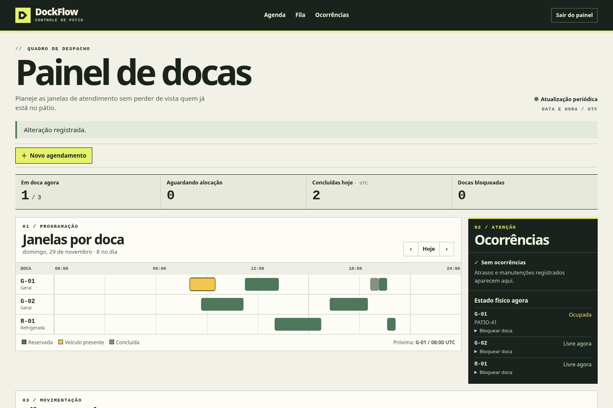

# DockFlow

**Agendamento de docas e gestão de pátio para centros de distribuição.** Uma transportadora reserva via API; a portaria registra a chegada; a operação aloca, inicia e conclui a descarga no painel. Uma doca bloqueada não aceita novas reservas, e visitas afetadas podem ser sinalizadas e realocadas sem mover um caminhão que já está em operação.



[Veja a demonstração de 15 segundos](docs/imagens/demo.mp4) · [Painel no celular](docs/imagens/mobile.png) · [Evidências e testes](docs/verificacao.md)

O quadro é organizado por **doca e horário**, como uma planilha de despacho. A grade mostra a programação do dia selecionado; o trilho de ocorrências mostra quem está fisicamente na doca **agora**, independentemente do horário da reserva.

## O que o projeto comprova

- **Concorrência:** 100 reservas autenticadas disputaram a mesma doca e janela. Uma recebeu HTTP `201`; as outras 99 receberam `409`. Uma janela adjacente foi aceita. A exclusão é do PostgreSQL, não de uma checagem antes do `INSERT`.
- **Agenda não é ocupação física:** uma descarga que passou do horário não libera automaticamente a doca. A máquina de estados valida as transições e uma restrição separada protege a ocupação.
- **Isolamento:** outra transportadora do mesmo tenant e uma transportadora de outro tenant não conseguiram consultar a reserva vencedora. API e painel usam, respectivamente, JWT e sessão OIDC com cookie; o tenant não vem do JSON enviado pelo cliente.
- **Falha do broker:** com RabbitMQ parado, a reserva, a auditoria e a outbox permaneceram duráveis. Após a recuperação, o Worker publicou e registrou o mesmo evento na inbox. Reentrega não equivale a um novo efeito.

## Rode em ambiente local

Pré-requisitos: Docker com Compose, Python 3 e OpenSSL. Nenhuma conta externa é necessária.

```sh
python3 scripts/bootstrap.py
docker compose up -d --build
python3 scripts/check_identity.py
python3 scripts/wait_ready.py
```

Abra **https://localhost:5191**. O laboratório usa certificado próprio; não o instale como raiz global. Entre com a conta fictícia `manager-a` e o valor gerado de `DOCKFLOW_OPERATOR_PASSWORD` no seu `.env` local. Não cole o valor em chats, logs ou PRs. As reservas de demonstração podem ser criadas pelo formulário ou por `python3 scripts/lab.py api`. Para finalizar, `docker compose down` remove os contêineres e preserva os volumes.

## Arquitetura

Monólito modular com **.NET 10 LTS, ASP.NET Core MVC/Razor e SignalR**. O domínio e os contratos de aplicação não conhecem HTTP, EF ou RabbitMQ. As migrations do EF Core versionam as garantias PostgreSQL; o runtime usa consultas Npgsql parametrizadas para transações, locks e tratamento de conflitos. Um Worker separado publica a outbox com confirmação e só dá ACK depois de confirmar a transação da inbox. Redis guarda apenas a contagem derivada de descargas concluídas; não decide disponibilidade.

- [Contratos HTTP e cenários verificáveis](docs/api.md)
- [Arquitetura e regras](docs/produto.md) · [Operação do laboratório](docs/operacao.md) · [Guia de estudo](docs/estudo.md)
- [Decisões: runtime](docs/adr/0001-runtime.md), [concorrência](docs/adr/0002-agenda-e-ocupacao.md) e [identidade/eventos](docs/adr/0003-auth-e-eventos.md)
- [Escopo de deploy e limites do laboratório](docs/deploy.md)

A aplicação é demonstrável localmente; o GitHub não hospeda uma instância pública do SaaS. Os dados e identidades usados nas capturas são fictícios.
