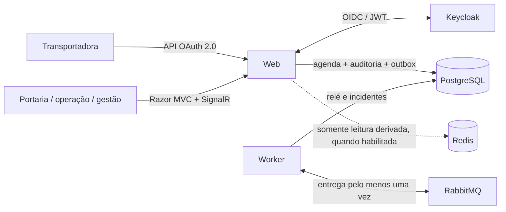

# Produto e invariantes

O DockFlow atende o centro de distribuição que precisa agendar carga, ordenar o pátio e manter decisões operacionais auditáveis. O laboratório usa exclusivamente organizações, veículos e identidades fictícias.

| Conceito | Invariante |
| --- | --- |
| Agenda | Intervalo `[início, fim)` em UTC. Duas reservas ativas para a mesma doca não podem se sobrepor; janelas adjacentes são válidas. |
| Categoria e peso | O filtro de compatibilidade precede a seleção de doca; uma preferência do cliente não substitui as regras. |
| Ocupação | Horário contratado não é o estado físico: o fim previsto não libera uma doca onde ainda há operação. |
| Autoridade | Tenant, papel e transportadora vêm de identidade autenticada. Saber um ID não concede acesso. |
| Incidente | Bloquear uma doca impede novas alocações. Planejamento afetado é sinalizado; realocação é explícita, sem mover um veículo em operação em silêncio. |
| Eventos | Uma reserva válida não depende de RabbitMQ ou Redis disponíveis. A mensagem sai após commit; consumo duplicado não autoriza efeito duplicado. |

## Fluxo e fronteiras

## Fluxo verificável

1. Reservar doca compatível e inspecionar o estado inicial.
2. Registrar chegada, atribuir doca e iniciar descarga, com autoridade e ordem explícitas.
3. Encerrar a descarga; comprovar que uma operação não iniciada não pode ser concluída.
4. Demonstrar reserva concorrente no PostgreSQL e manutenção enquanto chegam pedidos.
5. Interromper o RabbitMQ, confirmar a reserva, restaurar a mensagem e observar um único efeito.

Documentação e prova de laboratório não qualificam um deploy comercial nem autorizam conectar ERPs, infraestruturas compartilhadas ou contas reais.
